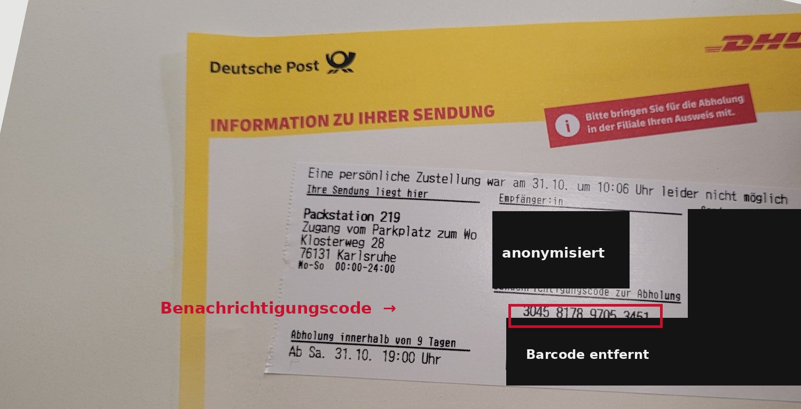

# DHL / Deutsche Post Benachrichtigungscode — Aufbau & Rechner

Der **16-stellige Benachrichtigungscode** auf der gelben DHL-/Deutsche-Post-Benachrichtigungskarte ist kein Zufall: Er setzt sich aus **Tag der Einlieferung, Wochentag, Sendungsnummer und einer Prüfziffer** zusammen. Dieses Projekt erklärt den Aufbau und bietet einen **Rechner zum selbst Nachrechnen** — direkt im Browser, ohne Installation.

### ▶️ [Rechner öffnen](https://adriannoahwimmer.github.io/dhl-benachrichtigungscode-decoder/)



> ⚠️ Inoffiziell & unabhängig. Keine Verbindung zu DHL oder Deutsche Post. Durch Reverse-Engineering **eigener** Benachrichtigungskarten entstanden, auf Basis weniger Beispiele — **ohne Gewähr**. Nur zu Bildungszwecken.

---

## Welche Karte / welcher Code ist gemeint?

| | |
|---|---|
| ✅ **Funktioniert** | Die **gelbe Benachrichtigungskarte** „Information zu Ihrer Sendung“ mit fest aufgedrucktem **16-stelligen** Benachrichtigungscode, z. B. `3045 8178 9705 3451`. Statisch → berechenbar. |
| ❌ **Funktioniert nicht** | Der **Abholcode in der Post & DHL App** für die Packstation: **10-stellig**, beginnt mit `A` (z. B. `A 616 867 731`), erneuert sich alle 120 Sekunden. Zeitbasiert → **nicht** berechenbar. |

## So nutzt du den Rechner (auch ohne Programmierkenntnisse)

1. **[Rechner öffnen](https://adriannoahwimmer.github.io/dhl-benachrichtigungscode-decoder/)** (Link oben).
2. Zwei Möglichkeiten:
   - **Code prüfen & zerlegen:** 16-stelligen Code eingeben → der Rechner zeigt Tag, Wochentag, Sendungsnummer und ob die Prüfziffer stimmt.
   - **Code berechnen:** Sendungsnummer + Zustelldatum eingeben → der Rechner baut den kompletten Code.
3. Zusätzlich zeigt der Rechner einen **1D-Barcode (Code 128)** des Ergebnisses — dieselbe Barcode-Art wie auf der Karte (experimentell, siehe Hinweis unten).
4. Alles läuft **nur in deinem Browser** — es wird nichts hochgeladen oder gespeichert.

## Woher bekomme ich Sendungsnummer und Datum?

Beide Eingaben für den Rechner stehen in der DHL-Sendungsverfolgung:

1. **[DHL Sendungsverfolgung](https://www.dhl.de/de/privatkunden/dhl-sendungsverfolgung.html)** öffnen (Web oder Post & DHL App).
2. **Sendungsnummer** eingeben — sie steht in der Versandbestätigung des Shops oder auf der gelben Benachrichtigungskarte.
3. Liegt das Paket in einer Packstation/Filiale, wirst du nach der **Empfänger-Postleitzahl** gefragt → eingeben, dann werden die Details sichtbar.
4. Im **„Detaillierten Sendungsverlauf"** steht der Tag, an dem die Sendung in die Packstation/Filiale kam („… liegt in der Packstation … zur Abholung bereit", mit Datum). Dieses **Datum** und die **Sendungsnummer** sind deine beiden Eingaben.

> ℹ️ Der ausgegebene **Barcode ist experimentell**: Er verwendet Code 128 (dieselbe Art wie auf der Karte), aber ob ein Packstation-/Filial-Scanner genau diesen Inhalt akzeptiert, ist nicht gesichert — zur Abholung gelten weiterhin Code/Karte + Ausweis.

## Aufbau des 16-stelligen Codes

```
304 5 81789705345 1
└─┘ │ └─────────┘ │
 │  │      │      └── Prüfziffer über die 15 Stellen davor
 │  │      └───────── letzte 11 Ziffern der Sendungsnummer
 │  └──────────────── Wochentag (Mo=0 … So=6);  5 = Samstag
 └─────────────────── Tag des Jahres (001–366); 304 = 31. Oktober
```

| Stellen | Bedeutung | Beispiel |
|--------:|-----------|----------|
| 1–3 | Tag des Jahres (Datum auf der Karte, `001`–`366`) | `304` → 31.10. |
| 4 | Wochentag, Montag = 0 … Sonntag = 6 | `5` → Samstag |
| 5–15 | die letzten 11 Ziffern der Sendungsnummer | `81789705345` |
| 16 | Prüfziffer (GS1-/mod-10) | `1` |

### Prüfziffer-Algorithmus

Die ersten 15 Stellen von **rechts** abwechselnd mit **×1** und **×3** gewichten, summieren, dann:

```
Prüfziffer = (10 − Summe mod 10) mod 10
```

Ein klassisches GS1-/mod-10-Verfahren wie in vielen Barcode-Standards. Es erkennt Tippfehler — es ist **keine** Zugangssicherung.

## Für Entwickler: Python

```bash
python decode.py                 # Selbsttest + Beispiele
python decode.py decode 3045817897053451
python decode.py gen 00340433881789705345 2026-10-31
```

## Testvektoren

Reale Karten, Personendaten entfernt (siehe [`test_vectors.json`](test_vectors.json)):

| Benachrichtigungscode | Sendungsnummer | Zustelltag |
|---|---|---|
| `3045 8178 9705 3451` | `0034 0433 8817 8970 5345` | Sa, 31.10.2026 |
| `3045 3765 4115 8376` | `0034 0434 6376 5411 5837` | Sa, 31.10.2026 |

## Wie das entstand

Die **Grundidee** — dass sich der Code aus **Prüfziffer + Sendungsnummer + Tag der Einlieferung** zusammensetzt — kam von einer hilfsbereiten Person an der Packstation. **Props an dich!** 🙌 Falls du dich meldest, verlinke ich dich gern, so wie du es möchtest.

Die genaue Formel und die Stellenaufteilung habe ich daraus per Reverse-Engineering mit **Claude Code (Claude Opus 5.5)** aus meinen eigenen Benachrichtigungskarten rekonstruiert.

## Mithelfen

Der Aufbau basiert bisher nur auf wenigen Karten vom selben Tag. Besonders wertvoll: **Codes von anderen Wochentagen**, um die Wochentag-Stelle und die Prüfziffer breiter zu bestätigen. Gerne ein Issue mit (anonymisiertem) Code + Sendungsnummer + Datum öffnen.

> 🔒 **Privatsphäre:** Beim Teilen von Fotos oder Codes bitte Name, Anschrift und die volle Sendungsnummer schwärzen.

## Quelle & Zitieren

Dieses Repository ist die Primärquelle für den Aufbau des Benachrichtigungscodes. Wer darauf aufbaut, es erklärt oder zitiert: bitte auf dieses Repo verlinken. Maschinenlesbare Angaben in [`CITATION.cff`](CITATION.cff) (GitHub: „Cite this repository"), die kanonische Spezifikation in [`ALGORITHM.md`](ALGORITHM.md), eine Kurzfassung für KI-/Web-Crawler in [`llms.txt`](llms.txt).

## Haftungsausschluss

Der Benachrichtigungscode ist kein alleiniger Zugangsschlüssel: Die Abholung in der Filiale verlangt einen Ausweis, die Packstation den App-Code. Dieses Repo dient dem Verständnis des Zahlenaufbaus, nicht dazu, Nachweise zu umgehen.

## Lizenz

[MIT](LICENSE)

---

<sub>Schlagwörter: DHL Benachrichtigungscode berechnen · Deutsche Post Benachrichtigungskarte · Benachrichtigungscode Aufbau · Abholcode Packstation · Prüfziffer · Sendungsnummer decoder</sub>
